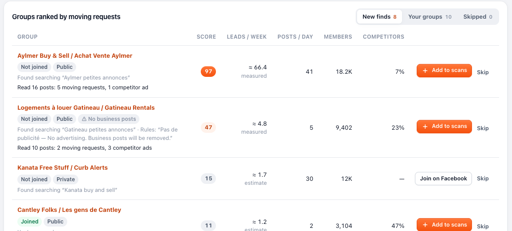

<h1 align="center">Lead Sniper</h1>

<b>Every moving request in your Facebook groups — spotted in seconds, answered with a reply that sounds like you.</b> English &amp; Québec French · Runs in your browser · Free to find leads

  <a href="https://github.com/hurbiexss/leadsniper/releases/latest/download/lead-sniper.zip"><b>⬇️ Download free</b></a> ·
  <a href="https://hurbiexss.github.io/leadsniper/">🌐 Website</a> ·
  <a href="https://hurbiexss.github.io/leadsniper/#pricing">⭐ Get Pro</a>

---

## The first good reply wins the job

Someone posts *“need movers Saturday”*, and within the hour the comments pile up. You were on a job, driving, or asleep. **Lead Sniper never is.**

It watches your local Facebook groups and spots every person asking for movers, deliveries or heavy-item help. You see the whole job at a glance, *4½ · 2nd floor, no elevator · Hull → Aylmer · Jul 1*, with a personal reply ready to post in one click.

## What it does

| | |
|---|---|
| 🎯 **Spots real customers** | Pulls out the job from each post: apartment size, floor, elevator, route, date, items and budget. |
| 🧹 **Ignores the noise** | Skips competitors' ads, job offers, people selling a couch and *“thanks to my movers”* posts. |
| ⚜️ **Fluent in Québec French** | *“qqn aurait un truck pour un frigo ce soir??”* is a lead. Reads joual, franglais, missing accents and typos. |
| ✍️ **Replies that sound like you** | Each reply is written from the customer's own words (their name, their couch, their date) and never repeats. |
| 🧭 **Group Hunter** | Finds the local groups worth watching and ranks them by moving requests per week. |
| 🤖 **Autopilot** `PRO` | Your reply posts itself the moment a scan finds a clear request, with limits, quiet hours and a free Rehearsal mode. |
| ⏱️ **Scheduled scans** | Every 15 minutes to once a day, with a desktop notification for every hot lead. |
| 🔒 **Private by design** | No account, no server, no AI service. Your leads stay in your browser, and it never asks for your Facebook password. |

### Real replies, written by Lead Sniper

> **Marie:** *Looking for movers for July 1st, 4 1/2 in Hull going to Aylmer. 2nd floor, no elevator.*
> **→** Hello Marie! Hull to Aylmer on July 1st — we'd be happy to take care of your move! Quotes and info at yourmovingco.ca — or just text 819-555-0142 🙂 — Your Moving Co.

> **Étienne:** *Quelqu’un aurait un camion pour aller chercher un divan sur Marketplace à Orléans demain?*
> **→** Allo Étienne! On peut aller chercher votre divan de Marketplace pour vous demain! Soumission et infos sur yourmovingco.ca — ou textez le 819-555-0142 🚚 — Your Moving Co.

## By the numbers

- **2 languages**: English and Québec French, including joual, franglais and typos
- **6,000+ posts per second** read by the lead engine
- **500 / 500** replies unique in our variety test, so no copy-paste spam
- **1,555 labelled posts** in the test suite it has to pass
- **0 servers**: everything runs in your browser

## Get started in 2 minutes

1. **[Download the zip](https://github.com/hurbiexss/leadsniper/releases/latest/download/lead-sniper.zip)** and double-click it to unzip. Keep the folder somewhere permanent.
2. Open `brave://extensions` (or `chrome://extensions`), turn on **Developer mode**, click **Load unpacked** and pick the folder.
3. On the welcome screen, enter your business name and your group links. Then scroll Facebook and watch the leads light up.

Works in **Brave** and **Google Chrome** on Mac, Windows and Linux.

## Pricing

| **Free**: $0 forever | **Pro Monthly**: $20 CAD / month | **Pro Yearly**: $150 CAD / year (save $90) |
|---|---|---|
| Leads in your feed, scheduled scans, notifications, one-click smart replies (EN/FR), Group Hunter, inbox, insights, CSV export, Autopilot Rehearsal | Everything in Free, plus **Autopilot**: replies post themselves, during scans and while you browse | Everything in Pro for $12.50 a month, covering the whole moving season and July 1st |

**How to get Pro:** copy your browser code (Lead Sniper → Settings → Lead Sniper Pro) and e-mail it to **[justinhurbie@gmail.com](mailto:justinhurbie@gmail.com)**, saying monthly or yearly. You'll get the amount and a **Bitcoin or Monero** address. Once payment confirms, your key arrives; paste it in Lead Sniper and Autopilot unlocks. Renew early and the unused days carry over. Want to try first? Ask for a **free 7-day trial key** at [justinhurbie@gmail.com](mailto:justinhurbie@gmail.com).

## Questions

**Is it safe for my Facebook account?** Lead Sniper reads pages the way you do, in your own logged-in browser, at a human pace. Autopilot posts from your account, and Facebook can limit accounts that post automatically. That's why Pro has hourly and daily limits, quiet hours, a wait between replies and a free Rehearsal mode.

**Where does my data go?** Nowhere. Posts, leads, replies and settings stay in your browser on your computer.

---

Made in Gatineau, Québec · Lead Sniper is not affiliated with Meta or Facebook.

